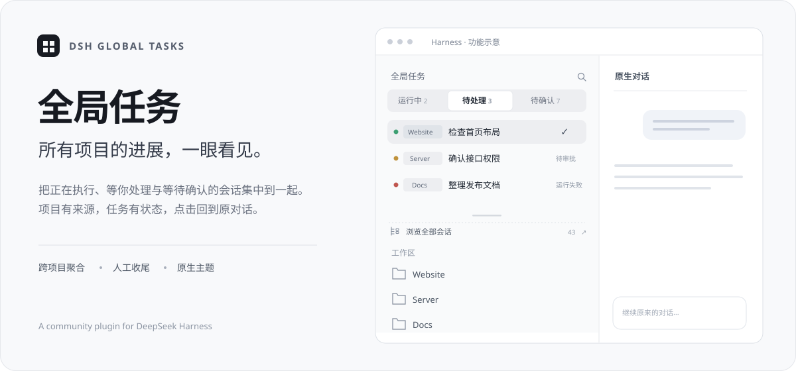
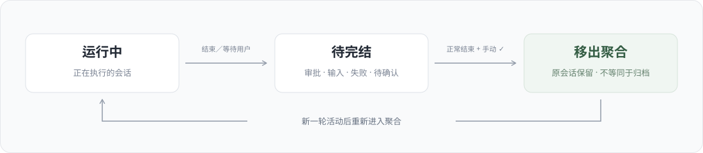

<p align="center">
  
</p>

<h1 align="center">DSH Global Tasks · 全局任务</h1>
<p align="center">所有项目的进展，一眼看见。</p>

<p align="center">
  <a href="https://github.com/AnsonLi-better/dsh-global-tasks/releases"></a>
  <a href="#兼容性"></a>
  
  
</p>

<p align="center"><a href="#安装">安装</a> · <a href="#使用">使用</a> · <a href="#状态规则">状态规则</a> · <a href="#兼容性">兼容性</a> · <a href="#常见问题">常见问题</a> · <a href="#开发">开发</a></p>

---

同时在多个项目里工作时，不必逐个展开工作区寻找正在运行或等待收尾的会话。**全局任务**在原工作区列表上方增加一个聚合区域，用「运行中 / 待完结」两个标签集中查看所有工作区的会话，每条显示所属项目，点击即可打开原会话。

> 社区插件，非 DeepSeek 官方产品。封面为功能示意，示例项目和任务均为虚构。

## 功能

| 功能 | 使用体验 |
| --- | --- |
| 跨工作区聚合 | 查看所有工作区的主会话，不受当前选中项目或列表折叠状态限制 |
| 两个筛选标签 | 「运行中」看正在执行的任务，「待完结」看等待审批、输入或人工收尾的任务 |
| 项目来源标签 | 会话标题前显示项目名；悬停可查看路径和状态 |
| 搜索与跳转 | 按项目、路径或会话标题搜索，点击使用 Harness 原生会话导航 |
| 人工标记完结 | 正常结束后点击 ✓，从聚合列表移除；原会话继续保留 |
| 自动重新出现 | 再次运行或收到新用户消息后，旧完结记录失效 |
| 原生视觉 | 继承宿主深浅色、字体及主题变量，保留原工作区列表 |

---

## 安装

**已验证宿主：DeepSeek Harness Desktop 0.2.1-rc.2。** 升级其他版本前请先阅读[兼容性](#兼容性)。

### 方式一：从 GitHub 直接安装（推荐）

仓库里已经带好构建产物 `client.js`，不需要自己编译。在终端执行：

```powershell
& "$env:LOCALAPPDATA/Programs/DeepSeek Harness/resources/runtime/cli/bin/dsh.cmd" `
  plugin --profile desktop add github:AnsonLi-better/dsh-global-tasks
```

安装完成后**重启 Harness**，左侧工作区列表上方会出现「全局任务」。

> 自定义安装位置时，把 `dsh.cmd` 的路径换成你的实际路径。
> 用 `--profile` 指定目标 profile，默认桌面端是 `desktop`。

### 方式二：在 Harness 里让助手安装

在 Harness 创造模式中说：

> 帮我安装全局任务插件：`github:AnsonLi-better/dsh-global-tasks`

助手会通过 `plugin_manager` 完成安装。

### 方式三：本地目录（开发用）

```powershell
git clone https://github.com/AnsonLi-better/dsh-global-tasks.git
& "$env:LOCALAPPDATA/Programs/DeepSeek Harness/resources/runtime/cli/bin/dsh.cmd" `
  plugin --profile desktop add "C:/path/to/dsh-global-tasks"
```

本地目录是本地链接的代码来源，安装后请保留该目录；移动目录后需要重新安装。

### 验证安装

```powershell
& "$env:LOCALAPPDATA/Programs/DeepSeek Harness/resources/runtime/cli/bin/dsh.cmd" `
  plugin --profile desktop why dsh-global-tasks
```

或在 Harness 插件管理器中确认「全局任务」处于启用状态。

### 卸载

```powershell
& "$env:LOCALAPPDATA/Programs/DeepSeek Harness/resources/runtime/cli/bin/dsh.cmd" `
  plugin --profile desktop remove dsh-global-tasks
```

适配层会卸载包装并恢复原工作区组件。人工完结元数据不等同于会话数据，卸载插件不会删除原会话。

---

## 使用

1. 在左侧原工作区列表上方找到「全局任务」。
2. 切到「运行中」查看正在执行的会话，或切到「待完结」处理等待和收尾事项。
3. 点击任意会话，进入原生对话界面查看结果。
4. 正常结束且确认收尾后，将鼠标移到该行，点击右侧 **✓** 标记完结。

完结后直接移除聚合行，不显示成功提示或撤销条，也不会跳走当前会话。需要回看时，仍从原工作区列表打开。

---

## 状态规则

<p align="center">
  
</p>

| 状态 | 所在标签 | 可以标记完结？ |
| --- | --- | --- |
| 正在执行 | 运行中 | 否 |
| 等待审批、等待输入 | 待完结 | 否，先处理等待事项 |
| 正常结束，等待人工确认 | 待完结 | 是 |
| 失败、中止等非正常结束 | 待完结 | 否，先处理或重新运行 |
| 已人工标记完结 | 移出聚合 | 原会话保留，新一轮活动后重新出现 |

**完结与归档相互独立。** 本插件不增加「已完成」或「全部」页面，归档仍使用 Harness 原有入口；已归档会话不参与聚合。子代理会话不重复展示，普通 fork 会话仍参与。

初次安装时，历史非空主会话也可能进入「待完结」，插件不会自动推断旧任务已经收尾。冷会话通过原生只读观察获取状态，无需为完结操作启动 Agent；若旧目录数据尚未带活动投影，可先打开会话加载状态。

---

## 兼容性

| 项目 | 当前情况 |
| --- | --- |
| 插件版本 | 0.1.0 |
| 已验证宿主 | DeepSeek Harness Desktop 0.2.1-rc.2 |
| 使用场景 | 本地 Desktop profile |
| 外观 | 跟随宿主浅色／深色主题 |
| 其他宿主版本 | 尚未验证 |

该宿主版本没有工作区前置区域插槽，因此插件通过**可卸载的组件包装**接入原生 `sidebar.workspaces`。这是针对当前版本的适配，不是官方稳定的装饰 API。升级 Harness 后应重新验证，勿绕过版本兼容检查强制加载。

插件包含结构检查和独立渲染错误边界。接口不匹配时不启用新增区域；新增区域渲染失败时隐藏该区域，以保留原工作区界面。

---

## 常见问题

**装完没看到「全局任务」？**
确认已重启 Harness，并用上面的 `plugin why` 命令确认包已安装。若 Harness 版本不是 0.2.1-rc.2，可能因接口不匹配而不启用。

**「待完结」里出现了很早以前的会话？**
这是预期行为。插件不会自动推断历史任务已经收尾，需要你手动点 ✓ 标记。

**点 ✓ 后会话会被删除或归档吗？**
不会。只移除聚合列表中的那一行，原会话完好保留，归档仍走 Harness 原入口。

**标记完结后它又出现了？**
说明该会话收到了新的用户消息或开始了新一轮执行，旧完结记录自动失效。

**卸载后我的完结记录会丢吗？**
会。完结元数据存在独立的 `local_global_tasks` storage domain 中，卸载插件不清理它，但重新安装后不会自动继承旧记录。

---

## 实现说明

- **状态来源**：原生会话、工作区和运行状态，结合 session projection 增量计算活动边界。
- **持久化**：独立 storage domain `local_global_tasks` 保存人工完结记录，用活动序号识别过期记录。
- **后台通信**：原生 `connection.fetch.register` 接口继承 Harness owner 认证及 Fetch/IPC 桥；不额外开启监听端口，也不因元数据操作触发模型请求。
- **聊天记录**：UI 的读取、完结操作不写聊天命令记录。显式调用 `/global-tasks` 命令则沿用宿主命令显示行为。
- **同步**：同源窗口用 BroadcastChannel 通知数据失效；连接重置和窗口获得焦点时重新读取，无定时轮询。
- **界面范围**：样式限制在新增任务区，复用原组件、导航和宿主提供的 React，不改写其他组件 DOM。

后台仍保留 `reopen` 操作用于显式恢复完结记录，但界面不显示撤销条。本插件没有提供多租户服务器的跨账号管理功能。

---

## 开发

```bash
npm ci
npm test
```

`npm test` 包含客户端构建、17 项自动化测试及入口语法检查。

单独构建与打包：

```bash
npm run build
npm pack
```

```
dsh-global-tasks/
├── index.js              # Host 插件入口
├── client.js             # 已构建的客户端产物（随仓库提交）
├── build.mjs             # esbuild 构建脚本
├── cordis.patch.yml      # bundle 注册
├── src/                  # 界面、状态、持久化与宿主适配
├── test/                 # 自动化回归检查
├── locale/               # 界面文案
├── docs/assets/          # README 插图
└── VALIDATION.md         # 本地桌面验收记录
```

当前自动检查覆盖跨项目聚合、子代理及归档排除、审批等待、过期完结记录、存储失败、响应竞争和适配层卸载恢复。核心行为已在真实桌面验收；随后按需求移除了成功提示及撤销条，这项界面调整已完成构建和语法检查，尚未重新执行桌面点击验收。具体范围见 [VALIDATION.md](VALIDATION.md)。

### 发布新版本

1. 改 `package.json` 的 `version`
2. `npm run build`（更新 `client.js`）
3. `npm test`
4. commit + push，然后打 tag：`git tag v0.1.0 && git push --tags`

`client.js` 必须一起提交——从 GitHub 安装时不会执行构建。

---

## 反馈

请附上 Harness 版本、插件版本、复现步骤，以及脱敏后的截图或错误信息。
[提交 Issue](https://github.com/AnsonLi-better/dsh-global-tasks/issues)

## 许可

MIT
